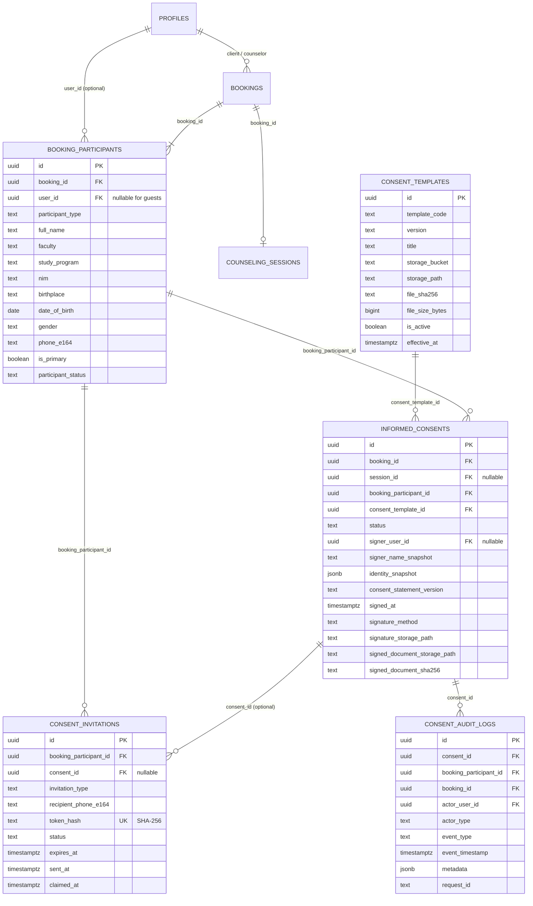

# SiCARE — Arsitektur Fondasi Digital Informed Consent (Batch 1.5b & 1.5b.1 Hardening)

**Status:** Selesai diimplementasikan dan dikeraskan keamanannya (124/124 backend tests PASS).
**Lingkup:** Desain skema database, versioning template informed consent, representasi peserta konseling (individu & kelompok, pemilik akun & tamu), token undangan kriptografis satu kali pakai dengan klaim atomik, pelacakan status consent per-peserta, isolasi privasi Klien Utama vs peserta kelompok, proteksi imutabilitas consent bertandatangan via trigger database, pembatasan format tanda tangan (PNG/JPEG), private Supabase Storage RLS, append-only consent audit trail, dan RPC kesiapan consent tervalidasi.
**Dokumen Arsitektur Keamanan:** [`docs/security/security-architecture.md`](security/security-architecture.md)
**Dokumen Penandatanganan & PDF:** [`docs/INFORMED_CONSENT_SIGNING.md`](INFORMED_CONSENT_SIGNING.md)
**Dokumen Alur Persetujuan Kelompok & WhatsApp:** [`docs/GROUP_CONSENT_WORKFLOW.md`](GROUP_CONSENT_WORKFLOW.md)
**Status Pengujian & Progres:** [`docs/PROJECT_STATUS.md`](PROJECT_STATUS.md)
**Migrasi Hardening:** [`supabase/migrations/20261031160000_sicare_consent_security_hardening.sql`](../supabase/migrations/20261031160000_sicare_consent_security_hardening.sql)

---

## 1. Templat Resmi Informed Consent

Dokumen acuan resmi tersimpan di:
`docs/reference/infromed-consent/informed-consent.pdf`

### Spesifikasi Dokumen Acuan:
- **Institusi Penyelenggara:** Lembaga Misi & Identitas (LMI) — Universitas Katolik De La Salle Manado, Indonesia.
- **Judul Dokumen:** `INFORMED CONSENT (Surat Pernyataan Kesediaan)`
- **Klasifikasi:** `CONFIDENTIAL` (Kerahasiaan Terjaga)
- **Ukuran Berkas:** 113.549 bytes (~111 KB)
- **Integritas SHA-256:** `59012141d8a54336928a4c076d9d0ad7276bbbc36064c37d9654cc031f14cd8f`
- **Preamble:** `Saya yang bertanda tangan dibawah ini :`

### Bidang Identitas Peserta (Formulir Fisik):
1. `Nama` (`full_name`)
2. `Fakultas/Prodi` (`faculty` dan `study_program`)
3. `NIM` (`nim` — nomor induk mahasiswa, format TEXT)
4. `Tempat, tanggal lahir` (`birthplace` TEXT dan `date_of_birth` DATE)
5. `Jenis kelamin` (`gender` — 'Laki-laki' / 'Perempuan')
6. `Telepon` (`phone_e164` — format E.164)

### Klausul Pernyataan Persetujuan (Teks Kanonis):
1. **Pernyataan Kesukarelaan:**
   > *"Menyatakan setuju dan bersedia untuk menjalani sesi bimbingan dan konseling dengan psikolog. Saya menyadari bahwa keikutsertaan saya dalam proses bimbingan dan konseling ini bermula dari kebutuhan pribadi untuk mendapatkan bantuan psikologis, sehingga bersifat sukarela, tanpa adanya paksaan dari pihak manapun."*
2. **Tanggung Jawab & Jaminan Kerahasiaan:**
   > *"Saya bertanggung jawab untuk menunjang keberlangsungan sesi. Saya memahami bahwa informasi yang saya berikan akan terjamin kerahasiaannya."*
3. **Pengecualian Kerahasiaan (Rencana Keselamatan):**
   > *"Untuk rencana keselamatan, saya memahami bahwa data dan identitas saya akan diserahkan kepada pihak yang berwenang jika ada resiko yang mengancam saya (klien), psikolog, atau pihak lain. Jika demikian, maka psikolog wajib dan berhak untuk bekerja sama dengan pihak lain yang berwenang."*

### Area Tanda Tangan:
- Lokasi & Tanggal: `Manado, __________________`
- Keterangan: `Yang menyetujui,`
- Garis tanda tangan penandatangan.

---

## 2. Skema Database

Migrasi kanonis:
[`supabase/migrations/20261031150000_sicare_informed_consent_foundation.sql`](../supabase/migrations/20261031150000_sicare_informed_consent_foundation.sql)

### Diagram Relasi Entitas (ERD)



---

## 3. Hubungan dan Kategori Peserta (Participant Architecture)

Sistem membedakan dua skenario konseling:

### A. Konseling Individu (`service_type = 'individual'`)
- Tepat **satu** peserta terdaftar per booking, yaitu Klien Utama (`primary_client`).
- Relasi: `booking_participants.user_id = bookings.client_id`, `is_primary = true`.
- Data identitas awal dipra-isi (*prefilled*) dari `public.profiles`.
- Klien menandatangani dokumen Informed Consent miliknya sendiri.

### B. Konseling Kelompok (`service_type = 'group'`)
- Satu booking menampung **2 sampai 10 peserta** (`participant_count`).
- Tepat **satu** peserta ditandai sebagai Klien Utama/Perwakilan (`is_primary = true`, `is_representative = true`).
- Peserta lain adalah Anggota Kelompok (`registered_member` atau `guest_member`).
- **Aturan Absolut:** Setiap peserta menandatangani dokumen Informed Consent masing-masing secara independen. Tanda tangan Klien Utama **tidak pernah** dianggap mewakili anggota kelompok lainnya.

### C. Pemilik Akun vs Tamu (Guest)
| Atribut | Peserta Berakun SiCARE | Peserta Tamu (Guest) |
|---|---|---|
| `booking_participants.user_id` | Berisi UUID `public.profiles(id)` | `NULL` |
| Autentikasi | Login via Supabase Auth | Akses via token undangan kriptografis satu kali pakai |
| Pengisian Identitas | Otomatis dari profil akun | Dilengkapi mandiri oleh tamu melalui tautan undangan aman |
| Akun Supabase Dummy | **TIDAK DIBUAT** | **TIDAK DIBUAT** |

---

## 4. Alur Persetujuan (Consent Workflows)

### Alur Konseling Individu
1. Klien membuat booking individu (`POST /api/v1/bookings`).
2. Layanan `ensureBookingParticipants` mendaftarkan Klien Utama ke `booking_participants`.
3. Layanan `initializeConsentForParticipant` membuat baris `informed_consents` berstatus `'pending'` dengan snapshot data identitas profil dan mengaitkan versi template aktif (`v1.0`).
4. Klien meninjau dokumen di antarmuka (Batch 1.5c) dan membubuhkan tanda tangan elektronik.
5. Dokumen PDF final digenerate dan diunggah ke private storage bucket.

### Alur Konseling Kelompok
1. Klien Utama membuat booking kelompok dan memasukkan nama/nomor telepon peserta.
2. Setiap anggota terdaftar di `booking_participants` dengan status `'registered'`.
3. Untuk setiap peserta, dibuat baris `informed_consents` berstatus `'pending'`.
4. Untuk anggota tanpa akun, dibuatkan token undangan satu kali pakai di `consent_invitations`.
5. Setiap peserta menerima tautan undangan privat, melengkapi data identitas (NIM, Fakultas/Prodi, TTL, Jenis Kelamin), meninjau dokumen, dan menandatangani secara mandiri.
6. Status kelengkapan dipantau secara real-time via `sicare_check_booking_consent_readiness`.

---

## 5. Mekanisme Undangan Aman (Invitation Architecture)

Pencegahan pencurian token dan serangan replay:
1. **Tidak Ada Penyimpanan Token Mentah:** Server menghasilkan token acak 32-byte (64 karakter heksadesimal) dengan entropi tinggi (`crypto.randomBytes(32)`). Hanya nilai hash SHA-256 (`token_hash`) yang disimpan dalam basis data.
2. **Kunci Tunggal & Kedaluwarsa:** Setiap token memiliki masa berlaku (default: 72 jam via `expires_at`).
3. **Sekali Pakai (Single-Use):** Saat diklaim dan formulir disetujui, status bertransisi: `pending -> claimed -> completed`.
4. **Pencabutan (Revocation):** Jika peserta diganti atau booking dibatalkan, token dapat diubah statusnya menjadi `revoked`. Token yang dicabut ditolak seketika oleh `verifyInvitationToken`.
5. **Isolasi Data:** Token tamu hanya memberikan akses ke baris peserta miliknya sendiri; tamu tidak dapat melihat data booking peserta lain atau dokumen peserta lain.

---

## 6. Arsitektur Penyimpanan Privat (Storage Buckets)

Supabase Storage dikonfigurasi sepenuhnya **privat** tanpa akses baca publik:

| Nama Bucket | Sifat | Batas Ukuran | Tipe MIME yang Diizinkan | Fungsi |
|---|---|---|---|---|
| `informed-consent-templates` | Privat (`public = false`) | 10 MB | `application/pdf` | Menyimpan berkas master templat resmi PDF per versi (`SICARE_IC_STD/v1.0/informed-consent.pdf`). |
| `informed-consent-signed` | Privat (`public = false`) | 15 MB | `application/pdf` | Menyimpan PDF hasil tanda tangan lengkap per booking & peserta (`{booking_id}/{participant_id}/{consent_id}.pdf`). |
| `informed-consent-signatures` | Privat (`public = false`) | 2 MB | `image/png`, `image/jpeg`, `image/svg+xml` | Menyimpan aset goresan tanda tangan elektronik beresolusi tinggi yang diunggah aman. |

### Aturan Keamanan Akses Berkas:
- Tidak ada URL permanen yang dapat diakses publik.
- Akses berkas oleh klien/konselor hanya dilakukan melalui **Short-Lived Signed URL** (misalnya berdurasi 5-15 menit) yang diterbitkan backend setelah verifikasi kepemilikan.
- Kredensial `service_role` hanya digunakan oleh server Express backend.

---

## 7. Keamanan Akses dan Row Level Security (RLS)

1. **`consent_templates`:**
   - Pembacaan (`SELECT`): Diizinkan untuk semua pengguna terautentikasi aktif (`client`, `counselor`, `admin`, `head_lmi`).
   - Modifikasi: Hanya `service_role` (atau admin institusional).
2. **`booking_participants`:**
   - Pembacaan (`SELECT`): Klien pemilik booking, konselor yang ditugaskan, atau peserta terautentikasi yang `user_id`-nya cocok.
   - Modifikasi: `service_role` backend.
3. **`informed_consents`:**
   - Pembacaan (`SELECT`): Penandatangan (`signer_user_id`), pemilik booking (`client_id`), atau konselor penanggung jawab (`counselor_id`).
   - Modifikasi: `service_role` backend.
4. **`consent_invitations`:**
   - Pembacaan (`SELECT`): Klien utama pembuat booking atau `service_role`.
   - Modifikasi: `service_role` backend. Tamu tidak mengakses tabel langsung, melainkan melalui endpoint backend yang memvalidasi hash token.
5. **`consent_audit_logs`:**
   - Pembacaan (`SELECT`): Khusus `admin` dan `head_lmi`.
   - Modifikasi (`UPDATE` / `DELETE`): **Dilarang untuk semua peran** melalui trigger PostgreSQL `consent_audit_logs_append_only`.

---

## 8. Audit Log Append-Only

Tabel `public.consent_audit_logs` mencatat seluruh peristiwa persetujuan tanpa dapat dimanipulasi:
- Peristiwa: `participant_registered`, `identity_updated`, `invitation_created`, `invitation_sent`, `invitation_claimed`, `consent_created`, `consent_viewed`, `consent_signed`, `document_generated`, `document_downloaded`, `consent_revoked`, `consent_expired`.
- Kolom audit tidak menyimpan gambar tanda tangan, token mentah, atau catatan klinis konseling (kepatuhan SOP privasi LMI).

---

## 9. Penegakan Consent Sebelum Sesi (Future Consent Enforcement)

RPC PostgreSQL `sicare_check_booking_consent_readiness(p_booking_id uuid)` disiapkan sebagai penentu keabsahan sesi:

```text
Konselor hendak memulai sesi (ongoing)
                  |
                  v
sicare_check_booking_consent_readiness(booking_id)
                  |
                  v
Semua peserta aktif berstatus 'signed'?
                /       \
              YA         TIDAK
              /             \
             v               v
      IZINKAN SESI      BLOKIR SESI
   (Sesi dimulai)   ("ALL_PARTICIPANTS_MUST_SIGN_CONSENT")
```

Pada Batch 1.5b, fungsi ini tersedia dan teruji. Pengaitan langsung ke RPC `sicare_transition_session` akan diaktifkan secara terukur pada Batch 1.5d/1.5e setelah antarmuka tanda tangan (Batch 1.5c) tersedia.

---

## 11. Implementasi Penandatanganan Digital & PDF Generation (Batch 1.5c)

Arsitektur penandatanganan dan pembangkitan PDF resmi (`pdf-lib`) telah diimplementasikan penuh pada Batch 1.5c. Rincian lengkap tersedia di [`docs/INFORMED_CONSENT_SIGNING.md`](INFORMED_CONSENT_SIGNING.md).

Ringkasan komponen:
- **Layanan Pembangkitan PDF (`be/src/services/consentPdf.service.js`):** Memverifikasi integritas templat master (`59012141d8a54336928a4c076d9d0ad7276bbbc36064c37d9654cc031f14cd8f`), memetakan 9 koordinat eksak teks/tanda tangan, dan memvalidasi biner tanda tangan PNG via magic bytes `89 50 4E 47 0D 0A 1A 0A`.
- **Layanan Transaksi Consent (`be/src/services/consent.service.js`):** Menyediakan `getConsentById`, `updateDraftConsentIdentity`, `signInformedConsent`, dan `getSignedDocumentDownloadUrl` dengan penjagaan imutabilitas (`SIGNED_CONSENT_EVIDENCE_IMMUTABLE`).
- **Rute API (`be/src/routes/consent.routes.js`):** Dipasang pada `/api/v1/consents/*`.
- **Pengerasan Storage RBAC (`supabase/migrations/20261031170000_sicare_consent_signing_and_document_rbac.sql`):** Kebijakan RLS objek storage untuk `informed-consent-signatures` dan `informed-consent-signed`.
- **Antarmuka Pengguna (`fe/src/components/consent/SignaturePad.tsx` & `InformedConsentModal.tsx`):** Canvas tanda tangan responsif high-DPI dan dialog penandatanganan mandiri.
