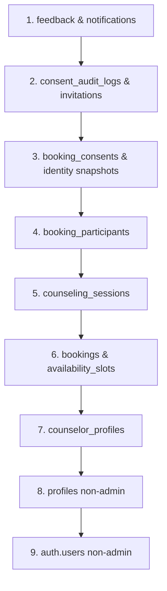

# Safe Database Cleanup & Reset Plan for Manual UAT

Tanggal: 1 November 2026
Status Rencana: **TERCATAT & MENUNGGU PERSETUJUAN PENGGUNA (PENDING APPROVAL)**
Status Eksekusi: **TIDAK ADA OPERASI PENGHAPUSAN ATAU MUTASI YANG DIJALANKAN PADA BATCH INI**

---

## 1. Lingkungan Target & Akun Admin Terverifikasi

### 1.1. Identifikasi Target Database
- **Supabase Host:** `https://tfzgztrvonkqsqmesmjy.supabase.co`
- **Tujuan Reset:** Menyiapkan basis data yang bersih (*clean-slate operational state*) untuk pengujian manual fitur (UAT) oleh tim penguji, dengan tetap mempertahankan akun Administrator utama yang sudah ada.

### 1.2. Akun Admin Kanonis yang WAJIB Dipertahankan (PRESERVED)
Berdasarkan hasil audit langsung ke Supabase Auth & tabel `profiles`, akun Administrator yang telah ada adalah:
- **Profile ID:** `2c165fc0-3483-4bdf-9dc0-8be6e020c759`
- **Email:** `markomakalew@gmail.com`
- **Nama Lengkap:** `Pengguna SiCARE`
- **Role:** `admin`
- **Status:** Aktif (`is_active = true`)
- **Waktu Dibuat:** `2026-10-28T13:51:15.780538+00:00`

> [!IMPORTANT]
> Akun ini **TIDAK BOLEH DIHAPUS** baik dari tabel `public.profiles` maupun dari tabel internal `auth.users`. Seluruh skrip pembersihan menggunakan filter eksplisit `id != '2c165fc0-3483-4bdf-9dc0-8be6e020c759'`.

---

## 2. Inventarisasi Data Aktual Remote Saat Ini

Hasil audit tabel pada proyek Supabase remote saat ini:

| Nama Tabel / Entitas | Jumlah Record Aktual | Klasifikasi Data | Tindakan Rencana Reset |
|---|---|---|---|
| `auth.users` | 4 pengguna | Identitas Akun | Hapus 3 akun non-admin, pertahankan Admin |
| `public.profiles` | 4 profil | Data Profil Pengguna | Hapus 3 profil non-admin, pertahankan Admin |
| `public.counselor_profiles` | 1 profil | Profil Konselor | Dihapus (akan didaftarkan ulang via UAT) |
| `public.academic_periods` | 0 record | Master Data Akademik | Dipertahankan jika ada / disiapkan via admin |
| `public.availability_slots` | 0 record | Operasional Jadwal | Dikosongkan |
| `public.bookings` | 0 record | Operasional Konseling | Dikosongkan |
| `public.booking_participants`| 0 record | Operasional Konseling | Dikosongkan |
| `public.counseling_sessions` | 0 record | Operasional Konseling | Dikosongkan |
| `public.feedback` | 0 record | Operasional Ulasan | Dikosongkan |
| `public.notifications` | 0 record | Operasional Notifikasi | Dikosongkan |
| `public.audit_logs` | Tersedia | Log Audit Operasional | Bersihkan entri pengujian lama non-admin |
| `public.hero_motivations` | 0 record | Master Teks Motivasi | Dipertahankan |

### Akun Non-Admin yang Terdaftar di DB Saat Ini (Kandidat Dihapus Saat Reset):
1. ID: `971629a7-0776-4299-b5b5-174a32d68e28` (Email: `24013037@unikadelasalle.ac.id`)
2. ID: `65368073-9ad1-4bb1-aa36-498ad2186b42` (Email: `marcomakalew0@gmail.com`)
3. ID: `ed52dd2f-831b-4a6d-ae86-2692341fe42c` (Email: `marcoismakalew@gmail.com`)

---

## 3. Temuan Kritis Migrasi Database Remote (*Critical Finding*)

Audit migrasi via `npx supabase migration list` menunjukkan:
- Database remote **hanya memiliki migrasi hingga versi `20261029100000`**.
- Migrasi lokal Batch 1.5c s.d. 1.5e berikut **BELUM DITERAPKAN DI REMOTE**:
  - `20261031120000_whatsapp_outbox.sql`
  - `20261031140000_informed_consent_foundation.sql`
  - `20261031160000_group_consent_closure.sql`
  - `20261031170000_pdf_signing_foundation.sql`
  - `20261031180000_consent_security_hardening.sql`

> [!WARNING]
> Sebelum pengujian manual fitur WhatsApp Outbox dan Informed Consent dapat diuji pada database remote, migrasi-migrasi di atas harus terlebih dahulu di-deploy ke Supabase remote setelah pengguna memberikan instruksi eksplisit. Pada Batch 1.5g.2 ini, sesuai aturan, tidak ada migrasi remote yang dieksekusi secara otomatis.

---

## 4. Urutan Pembersihan Aman (Foreign Key Dependency Order)

Untuk menghindari error *Foreign Key Constraint Violation*, urutan penghapusan harus dilakukan dari entitas anak (*leaf tables*) ke entitas induk (*parent tables*):



### Urutan Eksekusi Rinci:
1. `DELETE FROM public.feedback;`
2. `DELETE FROM public.notifications;`
3. `DELETE FROM public.whatsapp_outbox;` *(jika tabel sudah ada)*
4. `DELETE FROM public.consent_audit_logs;` *(jika tabel sudah ada)*
5. `DELETE FROM public.booking_consent_invitations;` *(jika tabel sudah ada)*
6. `DELETE FROM public.booking_consents;` *(jika tabel sudah ada)*
7. `DELETE FROM public.booking_participant_identity_snapshots;` *(jika tabel sudah ada)*
8. `DELETE FROM public.booking_participants;` *(jika tabel sudah ada)*
9. `DELETE FROM public.counseling_sessions;`
10. `DELETE FROM public.bookings;`
11. `DELETE FROM public.availability_slots;`
12. `DELETE FROM public.counselor_profiles;`
13. `DELETE FROM public.profiles WHERE id != '2c165fc0-3483-4bdf-9dc0-8be6e020c759';`
14. `DELETE FROM auth.users WHERE id != '2c165fc0-3483-4bdf-9dc0-8be6e020c759';`

---

## 5. Rencana Pembersihan Storage Bucket

- **Bucket `counselor-photos`:** Hapus file foto avatar pengujian sementara (jika ada); struktur bucket dipertahankan.
- **Bucket `consent-signatures` & `signed-consents`:** Pastikan bersih dari file PDF atau signature hasil mock lama.
- Jangan menghapus konfigurasi bucket atau RLS policy storage.

---

## 6. Skrip Dry-Run & Eksekusi Terkendali (Menunggu Konfirmasi Pengguna)

Skrip SQL disiapkan dalam transaksi ber-rollback (`ROLLBACK;`) untuk verifikasi jumlah baris yang terdampak sebelum dieksekusi secara permanen (`COMMIT;`).

### Skrip Dry-Run (Verifikasi Aman Tanpa Mengubah Data):
```sql
BEGIN;

-- Verifikasi akun admin yang dipertahankan
SELECT id, email, role, full_name
FROM public.profiles
WHERE id = '2c165fc0-3483-4bdf-9dc0-8be6e020c759';

-- Hitung record yang akan dihapus
SELECT count(*) AS non_admin_profiles_to_delete
FROM public.profiles
WHERE id != '2c165fc0-3483-4bdf-9dc0-8be6e020c759';

SELECT count(*) AS counselor_profiles_to_delete FROM public.counselor_profiles;
SELECT count(*) AS bookings_to_delete FROM public.bookings;
SELECT count(*) AS sessions_to_delete FROM public.counseling_sessions;

-- BATALKAN TRANSAKSI (DRY-RUN)
ROLLBACK;
```

---

## 7. Status & Langkah Berikutnya

- Rencana reset basis data ini telah dirancang secara presisi dan aman.
- **Tidak ada perintah DELETE atau manipulasi data yang dijalankan pada Batch 1.5g.2.**
- Eksekusi reset hanya akan dijalankan pada batch berikutnya apabila pengguna memberikan persetujuan eksplisit.
